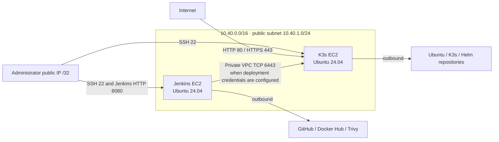

# Academic DevSecOps infrastructure

This Terraform root describes a two-EC2 academic lab in `ap-south-1`. It uses
one dedicated VPC and one public subnet in `ap-south-1a`; there is no NAT
gateway, load balancer, worker node, SSM management, or EC2 instance role.



Both instances receive a public IPv4 address for outbound access through the
Internet Gateway. There is no inbound SSH rule from the internet at large: TCP
22 and Jenkins TCP 8080 are limited to `admin_cidr`. Jenkins-to-K3s API traffic
uses the private VPC address and is allowed only from the Jenkins security
group. The K3s host accepts public TCP 80/443 for Traefik. Ports 3000, 6443,
8000, 8501, and 9090 are not open to the public.

## Required local inputs

Copy `environments/dev/terraform.tfvars.example` to the ignored local
`environments/dev/terraform.tfvars` and set:

- `admin_cidr` to the current administrator public IPv4 address in `/32`
  notation. Terraform rejects private, loopback, link-local, documentation,
  multicast, and reserved ranges. The ignored local academic tfvars currently
  uses the explicitly permitted `0.0.0.0/0` override, which opens SSH (22) to
  both EC2 hosts and Jenkins HTTP (8080) to every IPv4 address. This is an
  intentionally broad temporary exposure; replace it with the administrator's
  current `/32` before applying or as soon as possible.

The dev root references the existing EC2 key pair `kp251026` in
`ap-south-1` using an AWS data source and attaches it to both instances. The
key pair must exist in the selected AWS account and region before planning.
Terraform does not create, import, or modify it and does not need the private
key. Use the local `kp251026.pem` file with OpenSSH, for example:

```powershell
ssh -i "C:\path\to\kp251026.pem" ubuntu@<INSTANCE_PUBLIC_IP>
```

Keep the private PEM on the administrator's computer. Never put it in this
repository, Terraform variables, user data, outputs, or Git. Do not upload it
to AWS; only the matching public key was registered when the key pair was
created.

When `ami_id` is unset, both node modules discover the latest Canonical-owned
Ubuntu 24.04 AMD64 image through the EC2 `DescribeImages` API. No Systems
Manager Parameter Store lookup or instance-management role is used.

The local `.tfvars` and the private key are not to be committed. Confirm that
the existing AWS key pair is present in the selected account and region and
the administrator's current public IP has been entered before planning. Do
not substitute a guessed address.

## SSH and access

For PuTTY, convert the local PEM with PuTTYgen and keep the resulting private
`.ppk` file on the workstation only:

1. In **Session**, set Host Name to `ubuntu@<INSTANCE_PUBLIC_IP>` and port to
   `22`.
2. In **Connection → SSH → Auth → Credentials**, select the locally converted
   private key for `kp251026`.
3. Connect to the desired instance's Terraform output public IP. The login
   username is `ubuntu` for both hosts.

The Jenkins browser URL is `http://JENKINS_PUBLIC_IP:8080`. The Jenkins UI uses
plain HTTP in this academic design; it is limited by the Jenkins security-group
rule to `admin_cidr`, but HTTP is not production-grade transport security.
Use only a trusted network and do not reuse production credentials. Jenkins
membership in the `docker` group grants highly privileged, effectively
root-equivalent control of the host through the Docker daemon socket.

Public IPv4 addresses can change after an instance stop/start. Re-read the
Terraform outputs and update PuTTY, the Jenkins URL, DNS, and any operator
configuration when that happens.

## Jenkins bootstrap

Jenkins cloud-init installs Java 21 in its own apt transaction first. It selects
the Java 21 executable through `update-alternatives`, verifies that the active
`java -version` reports major version 21, and stops bootstrap if that check
fails. Only then does it install Git, Jenkins from the official LTS apt
repository, Docker Engine from Docker's Ubuntu apt repository, Docker Buildx,
the Docker Compose plugin, and Trivy `0.76.2` from Aqua Security's official
GitHub release. Before installation, it verifies the SHA-256 of the official
checksum manifest and Debian package, then confirms the package version and
AMD64 architecture. After the package transaction, cloud-init reloads systemd,
enables and starts Docker, adds the Jenkins account to the Docker group, and
starts Jenkins. If Jenkins was previously failed, it resets the failed unit
state before retrying startup. It finally verifies Java, installed tools,
service health, Jenkins Docker-group membership, and Docker daemon access as
the Jenkins user.
Installation output is written to `/var/log/jenkins-bootstrap.log` and
cloud-init's output log.

The current `Jenkinsfile` tests, scans, builds, and pushes immutable
commit-tagged Docker Hub images. It does not yet contain a K3s deployment
stage. Network reachability to TCP 6443 is present, but the root-readable K3s
administrative kubeconfig is not copied to Jenkins. Add a reviewed, least-
privilege deployment identity and pipeline stage before claiming automated
deployment; do not expose or copy the administrative kubeconfig automatically.

## K3s bootstrap

K3s cloud-init automatically installs the configured, checksum-verified
`v1.36.6+k3s1` server. The installer obtains the instance private IPv4 through
IMDSv2 and adds it as a TLS certificate SAN. The installer enables and starts
the K3s systemd service, checks that the node becomes `Ready`, confirms the
K3s-provided `kubectl` (creating a root-owned K3s wrapper only if absent), and
installs the official Helm `v4.3.1` Linux AMD64 release after checking its
published SHA-256. The administrative kubeconfig remains root-owned and mode
`0600`.

Inspect cloud-init and bootstrap results over SSH:

```sh
sudo cloud-init status --long
sudo tail -n 200 /var/log/cloud-init-output.log
sudo tail -n 200 /var/log/jenkins-bootstrap.log  # Jenkins host
sudo tail -n 200 /var/log/k3s-bootstrap.log      # K3s host
```

Verify the Jenkins host:

```sh
java -version
git --version
docker --version
docker buildx version
docker compose version
trivy --version
sudo systemctl status docker.service jenkins.service
```

Verify the K3s host:

```sh
sudo systemctl status k3s.service
sudo /usr/local/bin/k3s --version
sudo /usr/local/bin/kubectl --kubeconfig /etc/rancher/k3s/k3s.yaml get nodes -o wide
sudo /usr/local/bin/helm version --short
```

The only public K3s application entry points are Traefik's HTTP/HTTPS ports
80/443. Prometheus, Grafana, FastAPI, Streamlit, and the Kubernetes API remain
private behind their ClusterIP services or security-group rules. The K3s API
port 6443 accepts traffic only from the Jenkins security group. The Jenkins
pipeline still requires separately configured deployment credentials and a
deployment stage to use that route.

## Storage and data-loss boundary

Each EC2 instance uses an encrypted gp3 root EBS volume with
`delete_on_termination = true`. The separate K3s data volume and attachment
have been removed. K3s local-path PVC data, SQLite alert data, Prometheus TSDB,
Grafana data, and other host data reside on the K3s root volume and are lost
when that EC2 instance is terminated unless they are backed up first. Jenkins
home, credentials, workspaces, Docker layers, and scanner cache are also on its
root volume and are lost on termination.

Before using the cluster for valuable state, configure and test scheduled EBS
snapshots or AWS Backup, plus application-consistent backups for SQLite and
Jenkins configuration. Root-volume encryption does not provide backup or
retention.

## Terraform workflow

The dev root keeps its existing S3 backend and state key. The separate
`bootstrap-state` root and its state bucket are not changed by this academic
infrastructure root. Keep the AWS provider at the checked-in lockfile version
and authenticate using the AWS CLI credential chain; do not put AWS keys in
Terraform files.

From the repository root, validate and inspect a uniquely named plan:

```powershell
terraform fmt -check -recursive
terraform -chdir=terraform/environments/dev validate
$plan = "dev-academic-review-$(Get-Date -Format yyyyMMdd-HHmmss).tfplan"
terraform -chdir=terraform/environments/dev plan -out=$plan
terraform -chdir=terraform/environments/dev show -no-color $plan
```

Plan files are sensitive infrastructure artifacts and remain ignored by Git.
Review all planned changes before any apply. The user-data bootstrap downloads
packages and release artifacts on first boot, so successful Terraform planning
does not guarantee that external repositories are reachable at launch.

To remove only this dev infrastructure after reviewing the destructive
effects, run:

```powershell
terraform -chdir=terraform/environments/dev destroy
```

This destroys the dev root's EC2 instances, VPC, subnet, route, and security
groups. It does not delete the separately managed existing EC2 key pair or the separate
`bootstrap-state` S3 bucket. Both root disks are deleted when their instances
are terminated, so back up any stateful data before destroy. Never use this
command until the selected workspace and complete destroy plan are verified.
